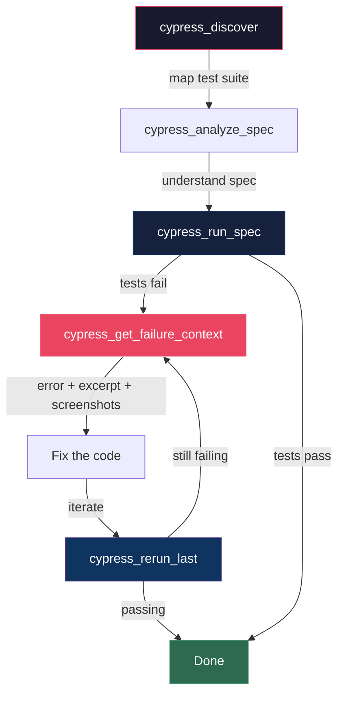

# cypress-mcp

[](https://www.npmjs.com/package/cypress-mcp)
[](LICENSE)
[](https://github.com/jams4code/cypress-mcp/actions/workflows/ci.yml)
[](https://nodejs.org)

MCP server that gives AI coding agents full control over Cypress test execution.

Run, debug, and iterate on E2E tests directly from Claude Code, Codex, GitHub Copilot, Cursor, Gemini CLI, or any MCP-compatible agent, without switching to a terminal. Works alongside [Cypress Cloud MCP](https://docs.cypress.io/cloud/integrations/cloud-mcp): record local runs to Cloud and hand the run URL straight to its tools.

## Requirements

- Node.js 22.12 or newer.
- Cypress installed in the project: `npm install --save-dev cypress`. cypress-mcp runs the project's own Cypress and never downloads one.
- For `cypress_run_test`: [`@cypress/grep`](https://github.com/cypress-io/cypress/tree/develop/npm/grep) registered in the support file or config.

## Setup

Every client starts the same command:

```bash
npx -y cypress-mcp --cwd /path/to/your/project
```

`--cwd` is the folder that holds `cypress.config.*`. Without it, cypress-mcp uses `CLAUDE_PROJECT_DIR` when Claude Code sets it, otherwise the directory the client starts it in. `cypress_doctor` tells you which project it found. A first `npx` run downloads the package, which can take several seconds: allow for it where the client has a startup timeout.

### Timeouts

A run takes from a few seconds to several minutes. cypress-mcp stops a run after 5 minutes by default (`defaultTimeout` in `cypress-mcp.config.json`, or `timeout` on the call, up to 1 hour) and returns the tests it finished and the one that hung. Keep the client's tool timeout above that, or the client gives up while Cypress is still running. Where a client needs a setting, the examples below use 15 minutes (Zed allows 10 at most).

| Client | Setting | Default |
|--------|---------|---------|
| Claude Code | `timeout` (ms) in the `.mcp.json` entry, or `MCP_TOOL_TIMEOUT` | About 28 hours. Stdio calls also end after 30 minutes without a response or progress notification; cypress-mcp sends one per test |
| Codex CLI | `tool_timeout_sec`, `startup_timeout_sec` | 60 s and 10 s: raise both |
| VS Code (`.mcp.json`) | `timeout` (ms) | 30 s, per the Copilot runtime reference: raise it |
| Gemini CLI | `timeout` (ms) | 10 minutes |
| Zed | `timeout` (s), `context_server_timeout` (s) | 60 s, capped at 600 s: keep runs under 10 minutes |
| Junie | `timeout` (ms, 1000 to 3600000) | 60 s: raise it |

Claude Desktop, Cursor, Windsurf (Devin Desktop), JetBrains AI Assistant and the Copilot cloud agent do not document a tool timeout.

### Claude Code

```bash
claude mcp add --transport stdio --scope project cypress -- npx -y cypress-mcp
```

This adds an entry like the one below to `.mcp.json` at the project root, which you can commit for the team:

```json
{
  "mcpServers": {
    "cypress": {
      "type": "stdio",
      "command": "npx",
      "args": ["-y", "cypress-mcp"]
    }
  }
}
```

No path is needed: Claude Code sets `CLAUDE_PROJECT_DIR` to the project root for the servers it starts, and cypress-mcp reads it. Add `"--cwd", "/path/to/your/project"` when the Cypress project is a subfolder. Progress notifications keep long runs alive, so no timeout setting is needed; add `"timeout": 900000` to cap a call at 15 minutes. Source: [Claude Code MCP docs](https://code.claude.com/docs/en/mcp).

### Claude Desktop

Edit `claude_desktop_config.json` (macOS `~/Library/Application Support/Claude/`, Windows `%APPDATA%\Claude\`, Linux `~/.config/Claude/`) and restart Claude Desktop. Paths must be absolute.

```json
{
  "mcpServers": {
    "cypress": {
      "command": "npx",
      "args": ["-y", "cypress-mcp", "--cwd", "/path/to/your/project"]
    }
  }
}
```

Source: [Connect to local MCP servers](https://modelcontextprotocol.io/docs/develop/connect-local-servers).

### Codex CLI

```bash
codex mcp add cypress -- npx -y cypress-mcp --cwd /path/to/your/project
```

Then raise the timeouts in `~/.codex/config.toml` (or `.codex/config.toml` in a trusted project):

```toml
[mcp_servers.cypress]
command = "npx"
args = ["-y", "cypress-mcp", "--cwd", "/path/to/your/project"]
startup_timeout_sec = 30
tool_timeout_sec = 900
```

The 60 second default stops most Cypress runs. For Cypress Cloud recording, add `env_vars = ["CYPRESS_RECORD_KEY"]` to forward the key from your environment. Source: [Codex MCP](https://developers.openai.com/codex/mcp), [configuration reference](https://developers.openai.com/codex/config-reference).

### VS Code (GitHub Copilot)

Copilot reads `.mcp.json` at the workspace root, or `~/.copilot/mcp-config.json` for every workspace, with a top-level `mcpServers` object:

```json
{
  "mcpServers": {
    "cypress": {
      "type": "stdio",
      "command": "npx",
      "args": ["-y", "cypress-mcp", "--cwd", "/path/to/your/project"],
      "tools": ["*"],
      "timeout": 900000
    }
  }
}
```

The older editor-managed format, `.vscode/mcp.json`, uses a `servers` key instead of `mcpServers` and supports `${workspaceFolder}`. VS Code marks it deprecated (removal planned for February 2027) but still offers it:

```json
{
  "servers": {
    "cypress": {
      "type": "stdio",
      "command": "npx",
      "args": ["-y", "cypress-mcp", "--cwd", "${workspaceFolder}"]
    }
  }
}
```

[Install in VS Code](https://vscode.dev/redirect?url=vscode%3Amcp%2Finstall%3F%257B%2522name%2522%253A%2522cypress%2522%252C%2522type%2522%253A%2522stdio%2522%252C%2522command%2522%253A%2522npx%2522%252C%2522args%2522%253A%255B%2522-y%2522%252C%2522cypress-mcp%2522%255D%257D) opens VS Code to review and add the server. From a terminal, `code --add-mcp '{"name":"cypress","type":"stdio","command":"npx","args":["-y","cypress-mcp"]}'` adds it to the editor-managed user configuration, where a server starts in the workspace folder, so it needs no `--cwd`.

Sources: [MCP configuration reference](https://code.visualstudio.com/docs/agents/reference/mcp-configuration), [install links](https://code.visualstudio.com/api/extension-guides/ai/mcp), [Copilot CLI reference](https://docs.github.com/en/copilot/reference/copilot-cli-reference/cli-command-reference) for `timeout`.

### GitHub Copilot cloud agent

In the repository, open Settings, then Copilot, then MCP servers, and add:

```json
{
  "mcpServers": {
    "cypress": {
      "type": "local",
      "command": "npx",
      "args": ["-y", "cypress-mcp", "--cwd", "."],
      "tools": ["*"]
    }
  }
}
```

The agent calls these tools without asking for approval. GitHub does not document the directory servers start in: if `cypress_doctor` finds no Cypress config, set `--cwd` to the checkout path shown in the session log.

The agent's firewall does not allow `download.cypress.io`, so install the Cypress binary in `.github/workflows/copilot-setup-steps.yml` (the job must be named `copilot-setup-steps`, and the file must be on the default branch). The firewall does not apply to setup steps.

```yaml
name: Copilot Setup Steps

on:
  workflow_dispatch:
  push:
    paths:
      - .github/workflows/copilot-setup-steps.yml

jobs:
  copilot-setup-steps:
    runs-on: ubuntu-latest
    permissions:
      contents: read
    steps:
      - uses: actions/checkout@v7
      - uses: actions/setup-node@v7
        with:
          node-version: 24
          cache: npm
      - run: npm ci
      # Downloads the Cypress binary, which the agent's firewall would block later.
      - run: npx cypress install
```

Setup steps run only when Copilot works on GitHub Actions, not in a cloud sandbox session. For Cypress Cloud recording, add an Agents secret named `COPILOT_MCP_CYPRESS_RECORD_KEY` and pass it with `"env": { "CYPRESS_RECORD_KEY": "$COPILOT_MCP_CYPRESS_RECORD_KEY" }`. Sources: [configure MCP servers](https://docs.github.com/en/copilot/how-tos/copilot-on-github/customize-copilot/configure-mcp-servers), [customize the agent environment](https://docs.github.com/en/copilot/how-tos/copilot-on-github/customize-copilot/customize-cloud-agent/customize-the-agent-environment), [firewall](https://docs.github.com/en/copilot/how-tos/copilot-on-github/customize-copilot/customize-cloud-agent/customize-the-firewall).

### Cursor

Add to `.cursor/mcp.json` in the project (or `~/.cursor/mcp.json` for every project). In the project file, `${workspaceFolder}` is the project root:

```json
{
  "mcpServers": {
    "cypress": {
      "type": "stdio",
      "command": "npx",
      "args": ["-y", "cypress-mcp", "--cwd", "${workspaceFolder}"]
    }
  }
}
```

Or paste this install link into your browser; Cursor asks before adding the server:

```text
cursor://anysphere.cursor-deeplink/mcp/install?name=cypress&config=eyJjb21tYW5kIjoibnB4IiwiYXJncyI6WyIteSIsImN5cHJlc3MtbWNwIl19
```

The link carries no `--cwd`: if `cypress_doctor` does not find your project, add `"--cwd", "/path/to/your/project"` to the server's `args`. Sources: [Cursor MCP](https://cursor.com/docs/mcp), [install links](https://cursor.com/docs/mcp/install-links).

### Windsurf (Devin Desktop)

Windsurf became Devin Desktop in June 2026. Add the server to `~/.config/devin/mcp_config.json` (Windows `%AppData%\devin\mcp_config.json`), or to `.devin/mcp_config.json` in the project for the Devin Local agent:

```json
{
  "mcpServers": {
    "cypress": {
      "command": "npx",
      "args": ["-y", "cypress-mcp", "--cwd", "/path/to/your/project"]
    }
  }
}
```

Source: [Devin Desktop MCP](https://docs.devin.ai/windsurf/plugins/cascade/mcp).

### Gemini CLI

Add to `.gemini/settings.json` in the project:

```json
{
  "mcpServers": {
    "cypress": {
      "command": "npx",
      "args": ["-y", "cypress-mcp"],
      "cwd": "/path/to/your/project",
      "timeout": 900000
    }
  }
}
```

If `gemini mcp list` shows the server as Disconnected, run `gemini trust` in the project folder: stdio servers only show as connected in trusted folders. Gemini CLI also removes inherited variables that match `*KEY*` (and `*TOKEN*`, `*SECRET*`) from the server's environment, so for Cypress Cloud recording pass the key explicitly: `"env": { "CYPRESS_RECORD_KEY": "$CYPRESS_RECORD_KEY" }`. Source: [Gemini CLI MCP servers](https://github.com/google-gemini/gemini-cli/blob/main/docs/tools/mcp-server.md).

### Zed

Add to Zed's `settings.json`:

```json
{
  "context_servers": {
    "cypress": {
      "command": "npx",
      "args": ["-y", "cypress-mcp", "--cwd", "/path/to/your/project"],
      "timeout": 600
    }
  }
}
```

Zed caps timeouts at 600 seconds, so keep cypress-mcp's run timeout below 10 minutes (the 5 minute default is fine). Source: [Zed MCP](https://zed.dev/docs/ai/mcp).

### JetBrains AI Assistant

In Settings, open Tools, AI Assistant, Model Context Protocol (MCP), click Add and paste the JSON configuration:

```json
{
  "mcpServers": {
    "cypress": {
      "command": "npx",
      "args": ["-y", "cypress-mcp"]
    }
  }
}
```

Set the Working directory field to your project folder; cypress-mcp then needs no `--cwd`. Source: [AI Assistant MCP](https://www.jetbrains.com/help/ai-assistant/mcp.html).

### JetBrains Junie

Add to `.junie/mcp/mcp.json` in the project, or `~/.junie/mcp/mcp.json` for every project:

```json
{
  "mcpServers": {
    "cypress": {
      "command": "npx",
      "args": ["-y", "cypress-mcp", "--cwd", "/path/to/your/project"],
      "timeout": 900000
    }
  }
}
```

Keep secrets such as `CYPRESS_RECORD_KEY` in the user file, not the committed project file. Source: [Junie MCP configuration](https://junie.jetbrains.com/docs/junie-cli-mcp-configuration.html).

### Which cypress-mcp is this?

This README is for the `cypress-mcp` package on npm, built from [jams4code/cypress-mcp](https://github.com/jams4code/cypress-mcp). Two unrelated GitHub projects, `yashpreetbathla/cypress-mcp` and `sbtungd2/cypress-mcp`, tell their users to run `npx cypress-mcp` or `npm install cypress-mcp`. Those commands install this package, not their code, and their flags (such as `--port` or `--base-url`) do nothing here. If you followed one of their guides, use that project's own install steps.

## Why

AI agents can write Cypress tests but can't run them. Every change requires you to switch to terminal, run `npx cypress run`, wait, copy the output back. This kills iteration speed.

**cypress-mcp** closes the loop. The agent runs specs, reads failures, views screenshots, inspects crash context, spots flaky tests, reruns the last command, and discovers the test suite, all within the conversation.

## Tools (12)

### Core Loop

| Tool | What it does |
|------|-------------|
| `cypress_run_spec` | Run a spec file headless, get structured JSON results (optionally recorded to Cypress Cloud) |
| `cypress_run_test` | Run a single test by name (grep filter); fails with the closest titles when the name matches nothing |
| `cypress_rerun_last` | Replay the exact last run without rebuilding arguments |
| `cypress_list_specs` | List all spec files with test counts |

### Debug

| Tool | What it does |
|------|-------------|
| `cypress_get_failure_context` | Compact debugging bundle: error, file and line, spec excerpt, screenshots, next actions |
| `cypress_get_screenshot` | Find failure screenshots by spec or test name |
| `cypress_get_last_run` | Full results of the most recent run, including per-test attempts and flaky flags |

### Discovery

| Tool | What it does |
|------|-------------|
| `cypress_discover` | Map the entire test suite: specs, test names, counts |
| `cypress_analyze_spec` | Deep-parse a spec: describe blocks, visits, intercepts, fixtures |

### Setup

| Tool | What it does |
|------|-------------|
| `cypress_get_config` | Resolved configuration and Cypress Cloud status (projectId, record key present) |
| `cypress_get_env` | Keys of cypress.env.json and the type of each value; values are never returned |
| `cypress_doctor` | Health check: config, binary, specs, support file, Cloud setup, directories |

## How It Works


- **stdio transport**: the agent spawns the server as a child process
- **Serial execution**: one Cypress run at a time, no concurrency
- **Progress and cancellation**: a progress notification per test for clients that ask for one; cancelling the request stops the whole Cypress process tree; a run that hits its timeout returns the tests it finished and the one that hung
- **Structured output**: JSON results with failure details, diffs, file and line, screenshot paths, attempts and flaky flags. A small Mocha reporter shipped in the package (`reporter/cypress-mcp-reporter.cjs`) replaces `--reporter json` for the run and prints the same report
- **Config-aware**: auto-detects `cypress.config.*`, follows relative imports, respects custom paths, and picks up changes to those files without a restart
- **No shell**: Cypress is started with `node` directly and every argument is passed verbatim, so test names and paths with spaces, quotes or `&` are safe on every platform
- **Stays in the project**: spec paths outside the project root are rejected, and `browser` only accepts names that `cypress info` lists (Cypress would otherwise run any executable path given there)
- **Cross-platform**: Windows, macOS, Linux

## Agent Workflow



## Flaky Tests

With [test retries](https://docs.cypress.io/app/guides/test-retries) enabled, every test result carries `attempts` and `flaky`. A test is flaky when it failed and then passed within the same run, the same rule Cypress Cloud uses. Run summaries count them (`All 12 tests passed in login.cy.ts (1 flaky)`), so the agent sees instability on the first run instead of after it reaches CI.

## Cypress Cloud

cypress-mcp runs tests on your machine. [Cypress Cloud MCP](https://docs.cypress.io/cloud/integrations/cloud-mcp) reads results recorded in Cypress Cloud: run history, flaky test analytics, Test Replay, UI Coverage and Accessibility. They do different jobs and work well together. No tool names overlap, so an agent can load both.

**Record a local run.** Pass `record: true` to `cypress_run_spec` or `cypress_run_test`, with optional `tags`, `group` and `ciBuildId`. The result includes the Cloud run:

```json
"cloud": {
  "runUrl": "https://cloud.cypress.io/projects/abc123/runs/42",
  "projectId": "abc123",
  "runNumber": 42
}
```

When a recorded run fails, `nextActions` points the agent at Cloud MCP's `cypress_get_failed_tests` with that URL, for Test Replay links and history.

**Setup.** Recording needs a `projectId` (read from your Cypress config, `CYPRESS_PROJECT_ID`, or `cypress-mcp.config.json`) and a record key. The key goes in the server environment, never in a tool call, so it never passes through the agent:

```json
{
  "mcpServers": {
    "cypress": {
      "command": "npx",
      "args": ["-y", "cypress-mcp", "--cwd", "/path/to/your/project"],
      "env": { "CYPRESS_RECORD_KEY": "your-record-key" }
    },
    "cypress-cloud": {
      "type": "http",
      "url": "https://mcp.cypress.io/mcp"
    }
  }
}
```

The `env` block goes in the server entry of whichever client you use (see [Setup](#setup) for client-specific notes). `cypress_doctor` reports whether recording is ready. Recording is opt-in per call and counts toward your Cypress Cloud test results.

## Configuration

Works out of the box for standard Cypress projects. For custom setups, create `cypress-mcp.config.json` next to your Cypress config:

```json
{
  "defaultBrowser": "chrome",
  "defaultTimeout": 600000,
  "cypressConfigFile": "config/cypress.config.ts",
  "specPattern": ["e2e/**/*.cy.ts"],
  "supportFile": "support/e2e.ts",
  "titleFilterSupport": true,
  "screenshotsDir": "cypress/screenshots",
  "projectId": "abc123"
}
```

Every field is optional. Without `defaultBrowser`, no `--browser` flag is passed and Cypress uses the project's own browser setting. `defaultTimeout` (milliseconds, default 300000) is the per-run limit; keep your MCP client's tool timeout above it (see [Timeouts](#timeouts)).

`cypress_run_test` filters by test title through [`@cypress/grep`](https://github.com/cypress-io/cypress/tree/develop/npm/grep). It is detected automatically when the plugin is registered in your support file or config. The filter is passed with `--expose` on Cypress 15.10+ (where `@cypress/grep` 7 reads it) and with `--env` for older plugin versions.

Env values passed to the run tools reach your tests through `cy.env()` on Cypress 15.10+ and `Cypress.env()` on older versions. They are sent as one JSON argument, so commas, quotes and string types are preserved.

## Supported Versions

- Cypress 14.x to 16.x. CI runs the end-to-end suite on Cypress 14 and on the latest release, on Linux and Windows. Older versions are not tested.
- Node.js 22.12+ (Node 18 and 20 are end of life)
- Windows, macOS, Linux

## Registry Status

| Registry | Package | Status |
|----------|---------|--------|
| **npm** | [`cypress-mcp`](https://www.npmjs.com/package/cypress-mcp) | Published |
| **MCP Registry** | `io.github.jams4code/cypress-mcp` | Published by the release workflow from 0.2.2 |
| **GitHub** | [`jams4code/cypress-mcp`](https://github.com/jams4code/cypress-mcp) | Source |

## Development

```bash
git clone https://github.com/jams4code/cypress-mcp.git
cd cypress-mcp
npm install
npm run build
npm test
```

## License

[Apache License 2.0](LICENSE). Free to use, modify and distribute, including commercially and in CI.

Copyright (c) 2026 [JADEV GROUP SARL](https://jadev-group.com) (BE1027.114.687), Brussels, Belgium. See [NOTICE](NOTICE).
